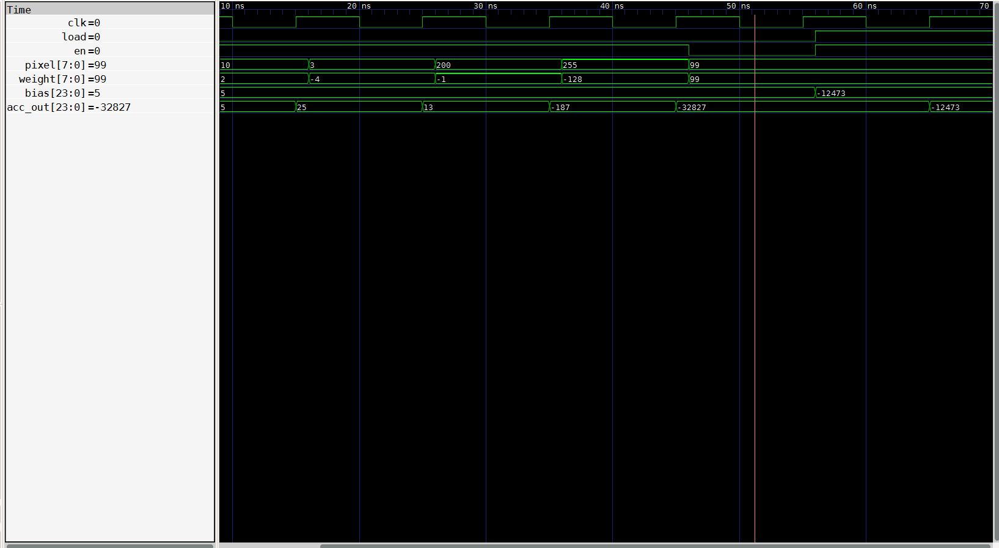

# MNIST Digit Classifier in Hardware

Goal: recognize a handwritten digit with a pure hardware circuit (VHDL). No CPU, no software, no floats, no division. Only addition, multiplication and comparison.

The project has two parts:

- **Python** (`python/`): trains a small network, converts it to integers, and exports the weights and test vectors. The integer model is the **bit-exact reference** for the circuit.
- **VHDL** (`VHDL/`): the circuit itself, built and verified module by module. See [VHDL status](#vhdl-status).

## Network

```
196 pixels → 16 neurons + ReLU → 10 scores → argmax
```

- Input: MNIST 28×28 downscaled to 14×14 (2×2 average, rounded), pixels 0–255
- Parameters: 16·196 + 10·16 = **3296 weights**, 16 + 10 = **26 biases**
- MAC operations per image: **3296**

## Files

| File | Purpose |
|---|---|
| `data.py` | Loads MNIST, downscales to 14×14, returns integer pixels `[N, 196]` |
| `train.py` | Trains the float model (SGD, lr 0.1, batch 64, 10 epochs, seed 0), saves `model_float.pt` |
| `quantitize.py` | Quantizes to integers, runs the integer reference model, exports files for VHDL |

> Note: the comments in the code are mostly in Azerbaijani. They are notes to myself, written while learning. Feel free to ignore them — the code doesn't read them either.

Run order:

```
cd python
python train.py
python quantitize.py
```

## Quantization (post-training)

| Symbol | Formula | Value |
|---|---|---|
| `s_w1` | `127 / max\|W1\|` | 115.0558 |
| `W1_q` | `round(W1 · s_w1)` | int8, range −127 … 113 |
| `b1_q` | `round(b1 · s_w1 · 255)` | range −12473 … 24079 |
| `k` | smallest k with `max(h1) >> k ≤ 255` (on training set) | **11** |
| `s_h` | `s_w1 · 255 / 2^k` | 14.3258 |
| `s_w2` | `127 / max\|W2\|` | 50.3694 |
| `W2_q` | `round(W2 · s_w2)` | int8, range −127 … 104 |
| `b2_q` | `round(b2 · s_w2 · s_h)` | range −453 … 456 |

Rule for biases: bias scale = weight scale × input scale. Pixels are scaled by 255 (training uses `x/255`).

No rescaling back to float is needed in hardware: all scales are positive, so ReLU and argmax give the same result on scaled values.

## Integer reference model (what the circuit must do)

```
z1   = x · W1_qᵀ + b1_q          # 16 values, accumulator starts at bias
h1   = max(0, z1)                # ReLU
h1_q = min(h1 >> 11, 255)        # requantize to unsigned 8-bit
z2   = h1_q · W2_qᵀ + b2_q       # 10 scores
out  = argmax(z2)                # ties → lowest index
```

Observed ranges on the training set: `z1` −269336 … 274371, `h1_q` 0 … 133.

## Results (10 000 test images)

| Model | Accuracy |
|---|---|
| Float | 94.45 % |
| Integer | 94.42 % |
| Same prediction | 9949 / 10000 |

Quantization cost: 0.03 %.

## Exported files

All values are binary strings, one per line, two's complement for signed values.

| File | Lines | Width | Content |
|---|---|---|---|
| `weights.txt` | 3296 | 8 bit signed | ROM contents |
| `biases.txt` | 26 | 24 bit signed | `b1_q` (16), then `b2_q` (10) |
| `images.txt` | 500 × 196 | 8 bit unsigned | first 500 test images, row-major 14×14 |
| `expected.txt` | 500 | 4 bit | **integer model** prediction (not the MNIST label) |

`expected.txt` holds the integer model's output so that any mismatch in simulation is a hardware bug, not a model error.

### Weight ROM layout

```
W1[j][i] → address j·196 + i          (0 … 3135)
W2[k][j] → address 3136 + k·16 + j    (3136 … 3295)
```

12-bit address. The FSM only increments the address counter; the order above matches the computation order.

## Hardware notes

- Product: 8-bit unsigned pixel × 8-bit signed weight. The pixel is zero-extended to 9-bit signed (`'0' & pixel`), so the VHDL product is 17 bits (values fit in 16), then sign-extended to 24 bits before accumulation.
- Accumulator: 24 bit signed (layer 1 worst case 196 · 32640 ≈ 6.4 M; layer 2 needs 20 bit).
- Order after layer 1: ReLU → `>> 11` → saturate at 255.
- Layer 2 input is the 16 stored `h1_q` values, same 0–255 format as pixels, so one MAC serves both layers.
- Argmax: use `>` (not `>=`) when scanning 0 → 9 to match Python tie-breaking.

## VHDL status

Each module has its own self-checking testbench. Expected values come from the Python integer model, not from the files the ROMs read.

| Module | Description | Status |
|---|---|---|
| `weight_rom` | 3296 × 8-bit signed, 12-bit address, synchronous read, initialized from `weights.txt` | ✅ verified |
| `bias_rom` | 26 × 24-bit signed, 5-bit address, synchronous read, initialized from `biases.txt` | ✅ verified |
| `mac` | 8-bit unsigned × 8-bit signed multiply, 24-bit accumulator; `load` starts a neuron at its bias, `en` accumulates, `load` has priority | ✅ verified |
| ReLU / requantize / argmax | `max(0, z)`, `>> 11`, saturate at 255, first-max index | ⏳ |
| FSM + top level | sequences 3296 MACs, stores 16 `h1_q` values | ⏳ |
| Full testbench | 500 test images vs. `expected.txt` | ⏳ |

ROM tests check the first entry, the largest and smallest values, the layer 1 / layer 2 boundary, and the last entry, which covers file path, bit width, sign and ordering errors.

The MAC test runs a short sequence with hand-computed results: load bias, then accumulate with a negative weight, a pixel above 127 (checks the `'0' & pixel` extension), and the extreme product 255 × −128; then hold with `en = 0`, and reload with `load` and `en` both high.



*`acc_out` goes 5 → 25 → 13 → −187 → −32827, holds while `en = 0`, and reloads the new bias (−12473) on `load`.*

### Running a testbench

Requires [GHDL](https://github.com/ghdl/ghdl) (and optionally GTKWave). Run from `VHDL/`:

```
ghdl -a --std=08 weight_rom.vhd weight_rom_tb.vhd
ghdl -e --std=08 weight_rom_tb
ghdl -r --std=08 weight_rom_tb --wave=rom.ghw
```

Same pattern for `bias_rom` and `mac`. A passing run prints the checked values and no `HATA` (error) lines.